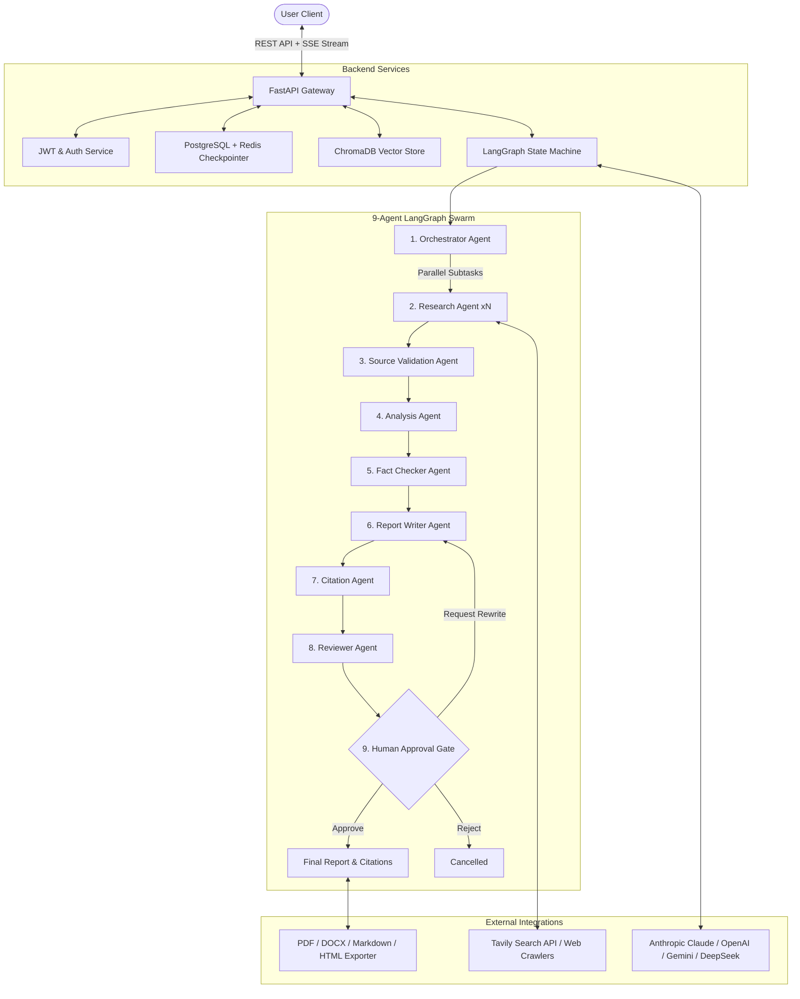

# NexusResearch AI - Multi-Agent Autonomous Research & Report System

[](https://www.python.org/)
[](https://fastapi.tiangolo.com/)
[](https://www.langchain.com/langgraph)
[](https://react.dev/)
[](https://www.typescriptlang.org/)
[](https://tailwindcss.com/)
[](https://www.docker.com/)
[](LICENSE)

An enterprise-grade, portfolio-quality autonomous deep research platform powered by **LangGraph**, **FastAPI**, **Anthropic Claude / OpenAI / Gemini**, **Tavily Search**, **PostgreSQL**, **Redis**, **Celery**, and **React 19**.

---

## 🌟 Key Architectural Highlights

* **9 Specialized Autonomous Agents**:
  1. **Orchestrator Agent**: Decomposes complex inquiries into 4–8 parallel research angles and multi-domain search queries.
  2. **Research Agent**: Concurrent web crawling via Tavily API and vector retrieval over uploaded documents.
  3. **Source Validation Agent**: Scores domain authority (0–100 Trust Score) across Government, Academic, News, and Corporate portals.
  4. **Analysis Agent**: Synthesizes quantitative statistics, CAGR projections, empirical benchmarks, and SWOT matrices.
  5. **Fact Checker Agent**: Adversarial cross-verification of claims against primary literature with an overall confidence meter.
  6. **Report Writer Agent**: Authors comprehensive 10-section strategic Markdown dossiers with embedded comparative data tables.
  7. **Citation Agent**: Formats references in APA, MLA, Chicago, IEEE, or Markdown Links with verified source URLs.
  8. **Reviewer Agent**: Audits grammatical precision, structural completeness, and logical flow (0–100 Quality Score).
  9. **Human Approval Gate**: Human-in-the-loop state checkpoint enabling one-click publishing, custom prompt rewrites, or rejections.
* **Zero-Config Instant Demo Mode**: Works completely out-of-the-box with real LLM keys (Anthropic Claude, OpenAI, Google Gemini) **OR** an intelligent high-fidelity Simulation Engine for instant local recruiter testing without API setup friction!
* **Real-Time Observability & SSE Streaming**: Live Server-Sent Events stream agent reasoning traces, latency benchmarks, and active node status transitions directly to the UI.
* **Interactive LangGraph Topology**: Visual Mermaid graph renderer highlighting active executing nodes in real time.
* **Multi-Format Export Engine**: Single-click exporting to styled **PDF**, **DOCX**, **Markdown**, **HTML**, **JSON**, and **CSV citations**.
* **Vector Knowledge RAG**: Built-in ChromaDB ingestion for user-uploaded PDF, DOCX, TXT, and Markdown files.
* **Voice Capabilities**: Speech-to-text voice input for research topic formulation + Web Speech audio briefing player.

---

## 🏗️ System Architecture & Workflow



---

## 🚀 Quick Start Guide

### Option A: Launch with Docker Compose (Recommended)

```bash
# 1. Clone repository
git clone https://github.com/your-username/multi-agent-research-system.git
cd multi-agent-research-system

# 2. Launch full stack (Postgres, Redis, FastAPI, Celery, React, Nginx)
docker compose up --build -d

# 3. Open application
# Frontend Client: http://localhost:3000 (or http://localhost:80)
# FastAPI OpenAPI Docs: http://localhost:8000/docs
```

---

### Option B: Local Single-Command Development

#### 1. Backend Setup (Python 3.12)
```bash
# Create and activate virtual environment
python -m venv venv
# Windows:
venv\Scripts\activate
# Linux/macOS:
source venv/bin/activate

# Install dependencies
pip install -r backend/requirements.txt

# (Optional) Seed demo database
python scripts/seed_db.py

# Start FastAPI backend
uvicorn backend.main:app --reload --port 8000
```

#### 2. Frontend Setup (React 19 + TypeScript + Vite)
```bash
cd frontend
npm install
npm run dev
```

Open `http://localhost:5173` in your browser.

---

## 📁 Repository Structure

```
01_Multi_Agent_Researcher/
├── backend/
│   ├── agents/            # All 9 independent LangGraph agent nodes
│   │   ├── orchestrator.py
│   │   ├── researcher.py
│   │   ├── validator.py
│   │   ├── analyzer.py
│   │   ├── fact_checker.py
│   │   ├── report_writer.py
│   │   ├── citation.py
│   │   ├── reviewer.py
│   │   └── human_approval.py
│   ├── api/               # FastAPI REST routers & SSE endpoints
│   │   ├── auth.py
│   │   ├── research.py
│   │   ├── reports.py
│   │   ├── sources.py
│   │   ├── files.py
│   │   ├── analytics.py
│   │   ├── admin.py
│   │   └── settings.py
│   ├── core/              # Config, Security, and LLM Provider Abstraction
│   │   ├── config.py
│   │   ├── security.py
│   │   └── llm_provider.py
│   ├── db/                # Async SQLAlchemy engine & session maker
│   ├── graph/             # StateGraph builder, state schema & reducers
│   ├── models/            # SQLAlchemy database models
│   ├── prompts/           # Versioned agent prompt engineering templates
│   ├── schemas/           # Pydantic v2 validation schemas
│   ├── services/          # Search, vector ingestion, and export services
│   ├── workers/           # Celery application & background tasks
│   ├── tests/             # Pytest suite (Agents, API, LangGraph)
│   └── main.py            # FastAPI main application
├── frontend/
│   ├── src/
│   │   ├── components/    # Glassmorphism UI components (Mermaid, LiveTerminal, TOC, etc.)
│   │   ├── context/       # AuthContext & ThemeContext
│   │   ├── pages/         # Landing, Dashboard, Workspace, Execution, Viewer, History, etc.
│   │   ├── services/      # Axios client & SSE stream listeners
│   │   ├── types/         # TypeScript definitions
│   │   ├── App.tsx
│   │   └── index.css
│   └── package.json
├── docker/
│   ├── Dockerfile.backend
│   └── Dockerfile.frontend
├── docs/                  # 9 Detailed Architecture & Technical Guides
│   ├── Architecture.md
│   ├── Agents.md
│   ├── LangGraph.md
│   ├── API.md
│   ├── Deployment.md
│   ├── PromptEngineering.md
│   ├── Database.md
│   ├── Memory.md
│   └── SequenceDiagrams.md
├── scripts/               # Seeding & dev launch scripts
├── .github/workflows/     # CI/CD pipelines
├── docker-compose.yml     # Multi-container orchestration
├── render.yaml            # Render deployment blueprint
├── vercel.json            # Vercel deployment configuration
├── Makefile
└── README.md
```

---

## 🧪 Testing & Quality Assurance

Run the comprehensive automated test suite with coverage:

```bash
# Run backend pytest suite
pytest backend/tests -v --cov=backend

# Run frontend typecheck
cd frontend && npm run build
```

---

## 📄 License

This project is licensed under the MIT License. See [LICENSE](LICENSE) for details.
