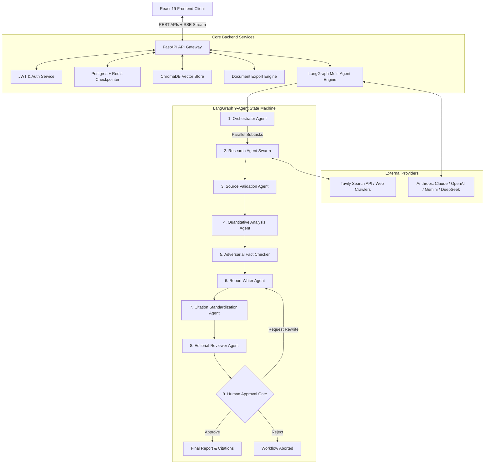

# System Architecture Documentation

## Overview

The **Multi-Agent Research & Report System** (`NexusResearch AI`) is an enterprise-grade autonomous intelligence platform engineered to execute end-to-end empirical research, cross-source fact-checking, and publication-ready report authoring using a decentralized swarm of 9 collaborating AI agents.

---

## High-Level Architectural Topology

---

## Architectural Layers

### 1. Presentation Layer (React 19 + TypeScript + TailwindCSS)
- **Real-Time Visualization**: Dynamic LangGraph execution monitor powered by Server-Sent Events (SSE) and interactive Mermaid graph topologies.
- **Glassmorphic AI SaaS Aesthetic**: Dark mode-first styling with sleek typography (Inter & JetBrains Mono), responsive layouts, and animated transitions.
- **Deep Reading Experience**: Sticky table of contents, auto-scrolling progress tracker, embedded comparative data tables, and inline citation drawer.

### 2. API Gateway & Middleware Layer (FastAPI)
- **Asynchronous Concurrency**: Built with Python 3.12 and AsyncIO for non-blocking parallel research execution.
- **Event Broadcasting**: Unbuffered Server-Sent Events (SSE) streaming real-time agent thoughts, node status, and log messages.
- **Security & RBAC**: Password hashing via Bcrypt, JSON Web Tokens (JWT), and automated demo authentication for recruiters and reviewers.

### 3. StateGraph Autonomous Agent Engine (LangGraph)
- **Shared State Management**: Typed dictionary state with annotated reducers allowing concurrent agents to append evidence simultaneously.
- **Dynamic Branching & Cyclic Retries**: Conditional routing edges supporting iterative human-guided rewrites without state loss.
- **Fault-Tolerant Checkpointing**: Memory checkpoints saving execution snapshots to PostgreSQL and Redis.

### 4. Search & Knowledge Fusion Layer
- **Tavily Search & Web Scraping**: Live multi-query web harvesting across government (.gov), academic (.edu, arXiv, Nature, IEEE), and corporate registries.
- **ChromaDB Vector Ingestion**: Semantic vector retrieval and cosine similarity search over user-uploaded PDF, DOCX, and TXT files.

### 5. Multi-Format Document Export Engine
- High-fidelity single-click exporting to **PDF** (styled headers, zebra tables), **DOCX**, **Markdown**, **HTML**, **JSON**, and **CSV**.
