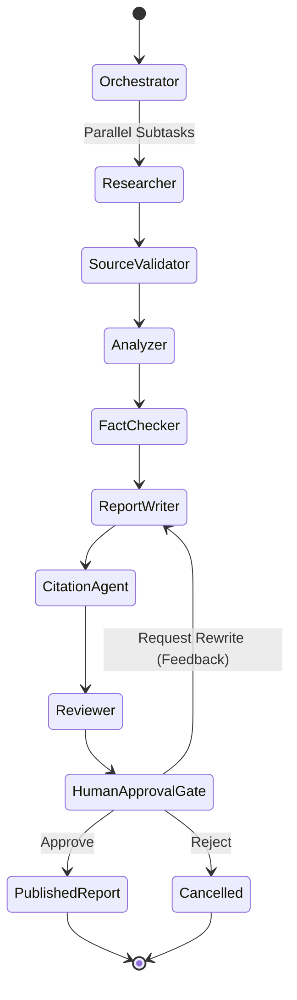

# LangGraph State Machine Architecture

## Graph Overview

The multi-agent workflow is modeled using LangGraph's `StateGraph`, enabling stateful orchestration, parallel execution branches, cyclical self-correction, and persistent checkpoints.



---

## State Schema (`ResearchState`)

The shared typed dictionary state leverages Python's `typing.Annotated` with `operator.add` reducers to enable safe concurrent writing by parallel worker nodes:

```python
class ResearchState(TypedDict):
    project_id: str
    topic: str
    depth: str
    language: str
    citation_style: str
    model_provider: str
    focus_areas: List[str]
    uploaded_file_ids: List[str]
    
    current_step: str
    progress_percentage: int
    status: str
    
    subtasks: List[Dict[str, Any]]
    research_plan_rationale: Optional[str]
    
    evidence: Annotated[List[Dict[str, Any]], operator.add]
    sources: Annotated[List[Dict[str, Any]], operator.add]
    
    validated_sources: List[Dict[str, Any]]
    source_stats: Dict[str, Any]
    analysis: Dict[str, Any]
    
    fact_checks: Dict[str, Any]
    confidence_score: float
    
    draft_report: str
    formatted_citations: List[Dict[str, Any]]
    
    review_notes: Dict[str, Any]
    quality_score: float
    
    human_approval_required: bool
    human_action: Optional[str]
    human_feedback: Optional[str]
    rewrite_count: int
    
    final_report: Optional[str]
    executive_summary: Optional[str]
    
    logs: Annotated[List[Dict[str, Any]], operator.add]
    agent_executions: Annotated[List[Dict[str, Any]], operator.add]
```

---

## Conditional Routing & Cyclical Loops

When the graph transitions through `HumanApprovalGate`, a conditional routing function assesses whether revision is requested:

```python
def route_after_approval(state: ResearchState) -> Literal["report_writer", "__end__"]:
    status = state.get("status")
    rewrite_count = state.get("rewrite_count", 0)

    # Route back to report writer if revision requested and under rewrite limit (max 3)
    if status == "rewriting" and rewrite_count < 3:
        return "report_writer"
    return "__end__"
```
